 

<table>
<tr>
<td width="50%" valign="top">

### About

I genuinely enjoy building software, not just to submit assignments, but because I like seeing things come to life.

One week it's low level Assembly, the next it's an Android app or a React frontend. I also care a lot about how things look. Clean UI, intuitive flow, layouts that feel obvious. That stuff matters to me.

**Currently**

- 6th semester CS at FAST-NUCES Lahore
- Building SafeCity, MindBloom and SkyRead
- Somewhere between x86 registers and a React component
- Always has something running on the side

</td>
<td width="50%" valign="top">

</td>
</tr>
</table>

 

 

## Things I've Built

<a href="https://github.com/SAyeshaGhaznavi/SafeCity">SafeCity</a> &nbsp;·&nbsp;
<a href="https://github.com/SAyeshaGhaznavi/MindBloom">MindBloom</a> &nbsp;·&nbsp;
<a href="https://github.com/MehrmahKhan/MovieHive">MovieHive</a> &nbsp;·&nbsp;
<a href="https://github.com/MehrmahKhan/SkyRead">SkyRead</a> &nbsp;·&nbsp;
<a href="https://github.com/MehrmahKhan/Inventory-Management-System">Inventory System</a> &nbsp;·&nbsp;
<a href="https://github.com/MehrmahKhan/space-shooter">Space Shooter</a>

 

## The Numbers

  

 

## Reach Me

 

