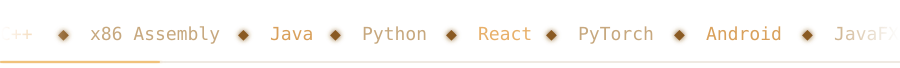

 

I genuinely enjoy building software, not just to submit assignments, but because I like seeing things come to life. One week it's low level Assembly, the next it's an Android app or a React frontend. I also care a lot about how things look. Clean UI, intuitive flow, layouts that feel obvious. That stuff matters to me.

 

 

## Things I've Built

 

<b>🏙️ SafeCity</b> &nbsp;·&nbsp; <code>Java</code> <code>SQL</code> &nbsp;·&nbsp; <i>open for details</i>

 

A smart real time platform that monitors criminal activity citywide and instantly alerts police, detectives, and emergency responders. Role based dashboards, live incident tracking, rapid response coordination. Built with a team, and I owned my features fully from UI to logic.

<b>🌱 MindBloom</b> &nbsp;·&nbsp; <code>Android</code> <code>Java</code>

 

A kids' learning app built for our HCI course. The challenge was designing for children, so every color, layout, and interaction had to feel natural for that age group. Handled my features end to end.

<b>🎬 MovieHive</b> &nbsp;·&nbsp; <code>React</code> <code>SQL</code>

 

A movie database web app inspired by Letterboxd. Browse movies, explore details, keep track of what you've watched. React frontend with a structured SQL backend. Still in progress but the core is coming together.

<b>🌤️ SkyRead</b> &nbsp;·&nbsp; <code>Python</code> <code>PyTorch</code> <code>ViT</code>

 

An image based weather detection system built with Vision Transformers (ViT-B/16) and Focal Loss. Detects 10 weather conditions from a single outdoor image using multi label classification. Based on Samo et al., Sensors 2023.

<b>📦 Inventory Management System</b> &nbsp;·&nbsp; <code>Java</code> <code>JavaFX</code>

 

A desktop app for real time inventory tracking with a clean GUI. Built with a teammate, took full ownership of my assigned features.

<b>🚀 Space Shooter</b> &nbsp;·&nbsp; <code>C++</code> <code>SFML</code>

 

2D arcade game with real time collision detection and progressive difficulty. Old project but it holds up.

<b>🧩 Sudoku &amp; 🌀 Maze Runner</b> &nbsp;·&nbsp; <code>x86 Assembly</code>

 

A fully working Sudoku puzzle game written in Assembly. Logic, constraints, and user interaction, all at register level.

Maze Runner does maze navigation in Assembly with low level memory management and control flow handling to make it actually work.

<b>💬 Social Media App</b> &nbsp;·&nbsp; <code>C++</code> <code>OOP</code>

 

Console based social platform built around OOP. Classes, inheritance, and file based persistent storage.

 

## The Receipts

  

  

 

## Reach Me

  

📍 Lahore, Pakistan

